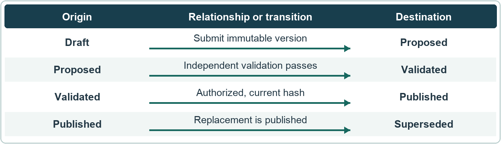

# Calendar and academic workflows

DOC-07 · Version 0.1 · proposed · Owner: Registrar

**Purpose and scope** — Control deadlines, registration stages and authorized state transitions.

**Audience** — Academic office and operations.

**Dependencies** — [Academic rule evaluation](06-academic-rule-engine.md), [Persian interface, accessibility and time](26-i18n-accessibility-time.md).

## Registration calendar
The registrar assigns the term zone, operation windows and student appointments. Intersect term and assignment windows. All are half-open intervals [open, close). Use PostgreSQL clock_timestamp() after acquiring the relevant locks, immediately before the decision writes. Processing a queued request confers no priority by receipt time. A retry after rollback receives a new decision time; replay of an already recorded outcome does not revisit the deadline.
Students assemble drafts without minimum-credit enforcement. Committing an addition enforces prerequisites, corequisites, repeat and upper limits. Explicit finalization (API-014) enforces the lower limit. A later change to a finalized plan must satisfy the lower limit or record an authorized grant. Persist the finalization state and decision reference on the student-term row.

A term moves through planning, published scheduling, registration open and closed as configured tasks and time gates become eligible. Keep teaching and registration dates separate where late adds overlap instruction. For equal-time operations, the database decision instant and the recorded eligibility interval settle the boundary. A human appeal cites the term, appointment, policy edition and request reference.

## Approval and publication
An exception request captures the exact student, term, rule, policy edition and expiry. A different authorized actor approves or rejects with justification. Revocation starts review of dependent records. Editing a validated timetable creates a new draft. Approval targets a particular validation and hash. A published version becomes superseded only when its replacement is published in the same transaction.

## Office decisions
Templates may generate appointments from ratified priorities. A calendar edit affecting a live term requires impact sampling, an audit entry, a term epoch increment and notification. Record local display time and offset on the confirmation screen to help resolve deadline disputes.

## Decision and open question
Proposed: Use the guarded database decision instant for eligibility. Assumed: The registrar can enumerate operation-specific windows.

Needs approval (RISK-003) — Jurisdiction, timezone, calendar and interval policy. Product owner: Record institutional zone, conflict policy and counsel review.

## References
[state machines](../artifacts/state-machines.yaml) · [openapi](../artifacts/openapi.yaml)
