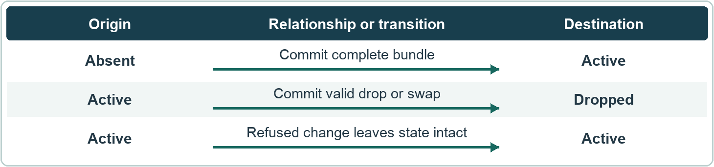
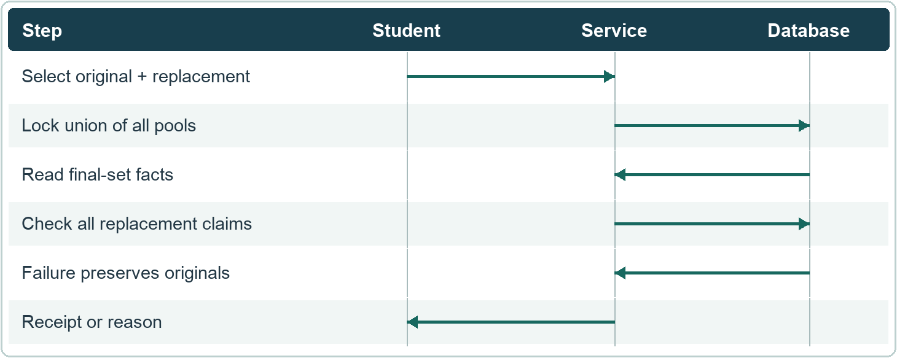
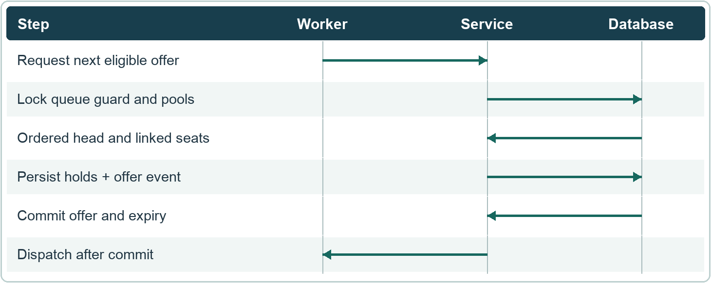

# Enrollment and waitlists

DOC-09 · Version 0.1 · proposed · Owner: Registrar

**Purpose and scope** — Coordinate additions, drops, swaps, offers and exceptions across shared pools.

**Audience** — Registration staff and backend engineers.

**Dependencies** — [Academic rule evaluation](06-academic-rule-engine.md), [API contracts and errors](16-api-contracts-errors.md), [Registration transactions](17-transactions-consistency.md).

## Student changes
Preview the full set with advisory availability. For a commit, take the union of added sections and existing active rows minus removals. Check linked-component compatibility, intervals, duplicate courses, credits, qualifications of granted exceptions and eligibility. Save all rows and claims atomically. A failed swap preserves both the old enrollment and its claims. A batch containing a lecture and corequisite can succeed even if either would fail alone.

## Reserved capacity and queues
For pool capacity C let U be active claims including live offers. For each unreleased quota q let p(q) be max(0, quota(q) minus its tagged claims). A general claim needs C−U−sum(p) > 0. An eligible reserve uses an available tagged seat; otherwise it competes for a general seat under the approved ordering. Distinct eligibility groups or a deterministic approved group choice prevent multiple reservation credits for one claim. Enforce sum of unreleased quotas <= C under pool lock. Consume a claim in every distinct required pool or none.
The proposed priority key is approved tier ascending, joined_at ascending, entry ID ascending. Tier definitions need registrar approval. Serialize queue decisions through the term’s queue guard before locking students and pools. For overlapping bundles, compare eligible requests that contend for any required pool. Grant the earliest eligible complete bundle first; skip a temporarily blocked bundle only under a ratified bypass rule, otherwise preserve its place. Never use parallel SKIP LOCKED selection to pick academic winners.
The queue_guard design serializes seat-changing operations per term. Its cost is visible in lock wait telemetry. Before introducing per-pool shards, demonstrate equivalent priority on a bundle spanning two shards, including a simultaneous direct request and reserve expiry.

## Offer lifecycle
Promotion creates expiring holds on all required pools after checking the candidate. An offer accepted before expiry replaces the holds with enrollment claims in the same transaction. A decline, expiry or definitive failure releases all holds and advances the queue. Transient failures retain position and retry; preserve a reason for ineligibility. Re-entry creates a new queue position unless an approved appeal restores priority. The direct command yields to the same ordering. Staff must not mint extra physical capacity through an exception.

## Decision and open question
Proposed: Reserve the entire offered bundle until acceptance or expiry. Assumed: Queue contenders can be compared for overlapping physical pools.

Needs approval (RISK-002) — Waitlist tiers, reserve release and allocation tie-breaks. Registrar: Approve priority, bundle contention and appeal process.

## References
[state machines](../artifacts/state-machines.yaml) · [test scenarios](../artifacts/test-scenarios.yaml)
