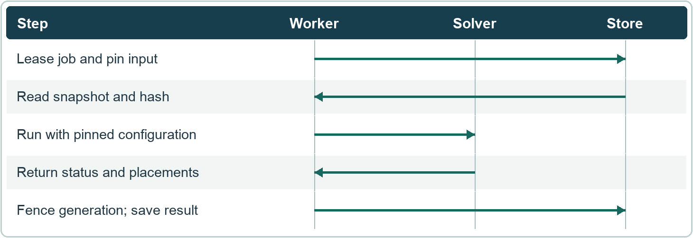
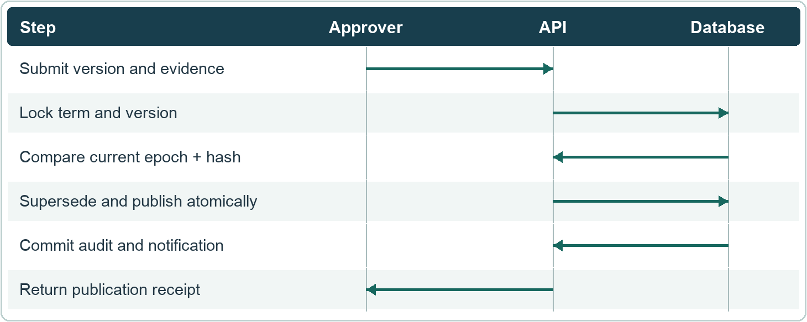

# Timetabling optimization

DOC-10 · Version 0.1 · proposed · Owner: Planning lead

**Purpose and scope** — Choose feasible placements and validate a timetable before publication.

**Audience** — Optimization engineers and faculty planners.

**Dependencies** — [Instructors, resources and offerings](08-faculty-resources-offerings.md), [Events, jobs and integrations](18-events-jobs-integrations.md), [Instructor and timetable planner guide](28-faculty-planner-user-guide.md).

## Model and feasible domains
Constraint Programming with a Boolean satisfiability solver (CP-SAT) chooses integer-valued assignments. Let C be the set of classes, P(c) the admissible placements for class c, I the instructors, R the rooms and W the teaching weeks. A placement fixes instructor, room, campus and a sequence of local dated half-open intervals. Expand makeup dates and exclusions before checking overlap. Generate combined placements for linked sessions or add compatibility constraints across component choices.
Set binary x(c,p) to 1 when c uses p. Enforce sum over P(c) of x(c,p) = 1. For incompatible placements (c,p) and (d,q), require x(c,p)+x(d,q) <= 1. Empty domains fail preflight with the reasons for eliminations. Instructor assignment can first build qualified candidates. Do not freeze an assignment if that makes the placement problem unnecessarily infeasible.
|Constraint|Hard feasibility test|
|---|---|
|CON-001 Resource eligibility|Remove placements lacking qualifications, essential equipment, accessible features or permitted room capacity.|
|CON-002 Occurrence conflicts|For each dated overlap or insufficient inter-campus travel gap, forbid simultaneous use of the room or instructor.|
|CON-003 Teaching pattern|Check meeting count, duration, week pattern, linked lecture/lab ordering, approved instructor load and any guaranteed cohort conflicts.|
|CON-004 Published commitments|Pin approved placements. Only an authorized repair can create a candidate with changed pins.|
Minimize a lexicographic vector of approved priority penalties. Within each tier use integer weights for undesirable time, idle gaps, uneven distribution, travel, likely demand clashes, room waste and deviations from the previous version. Solve higher tiers first and constrain their scores before lower-tier improvement. A soft penalty never admits an infeasible assignment. Probabilistic demand is a preference; a guaranteed cohort entitlement may be hard.

## Search, diagnosis and reproducibility
Normalize IDs, expand dates, remove invalid domains and check obvious room/load contradictions. Seek feasibility, then improve the incumbent inside SOLVE_BUDGET. Report objective vector, bound if available, elapsed time and unassigned classes. FEASIBLE has a witness; OPTIMAL also has a proof for the objective. INFEASIBLE requires a proof. UNKNOWN records absence of a conclusion and MODEL_INVALID requires model repair. A sufficient conflict subset under supported assumption literals may contain redundant members. Never silently weaken a hard constraint.
Benchmark manual incumbents, small enumerable fixtures and anonymized representative peaks on identical inputs and hardware. Compare hard violations, feasible rate, bound gap, first-feasible latency and disruption. Minimum-cost flow can assign qualified instructors when placement coupling is absent. Faculty decomposition needs globally coordinated shared resources or a master allocation.
The input contract carries pruned placements, explicit cross-class forbidden pairs, per-instructor load caps and ordered objective tiers. Expand travel, linked teaching patterns and guaranteed cohort conflicts into forbidden pairs. Multiply each placement’s preferenceCosts by approved tier weights and sum by tier; compare vectors lexicographically. In the one-tier fixture, penalty and objectiveScore are the first tier. sourceFactsRef locates the independent evidence used to check pruning and validate a candidate.

Persist input bytes and SHA-256 hash, normalized placement domains, source revisions, solver build, settings, seed, parallelism, result, scores and excluded classes. Parallel search and build changes can yield different incumbents. The supplied miniature domain has A2 and B1 feasible with penalty 3. Its result is a hand-authored example.

## Validation and repair
A separate validator reconstructs rules from original resource records, expands occurrences and recalculates conflicts and scores. It checks manual and solver candidates with the same publication gate. Compare current term epoch, candidate hash and validation reference under the publication guard. Displacement analysis reports enrolled students, room accessibility and instructor travel. Obtain a different authorized approver before publication; notify on commit.

## Decision and open question
Proposed: Require a feasible witness and a fresh independent validation before publication. Assumed: Planning inputs can be frozen and hashed per run.

Needs approval (RISK-006) — Solver weights and hard cohort commitments. Planning lead: Approve constraints and representative benchmark corpus.

## References
[solver input.schema](../artifacts/schemas/solver-input.schema.json) · [solver output.schema](../artifacts/schemas/solver-output.schema.json) · [solver input](../artifacts/examples/solver-input.json) · [solver output](../artifacts/examples/solver-output.json)

[CP-SAT Solver](https://developers.google.com/optimization/cp/cp_solver)
