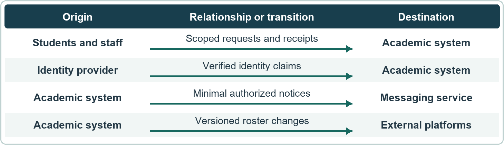
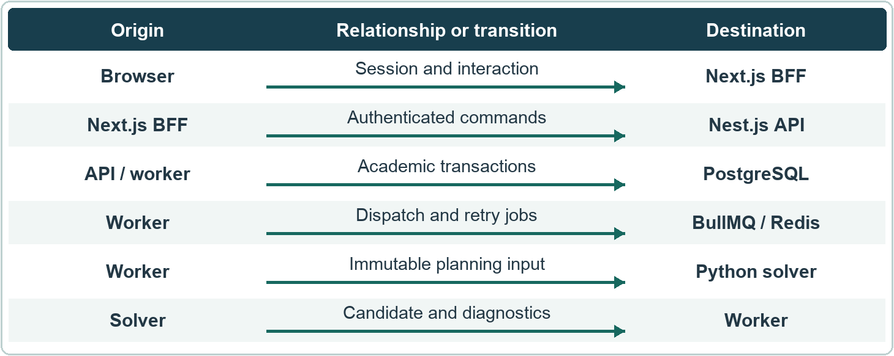
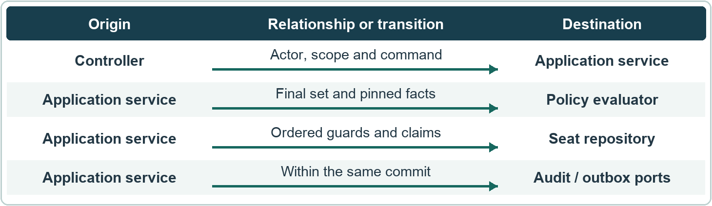
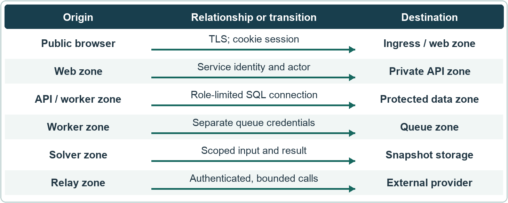

# System architecture

DOC-12 · Version 0.1 · proposed · Owner: Architecture lead

**Purpose and scope** — Set trust boundaries, write ownership and deployment responsibilities.

**Audience** — Engineering and operations.

**Dependencies** — [Nest.js application design](13-nestjs-backend-design.md), [Next.js frontend and user experience](14-nextjs-frontend-ux.md), [Registration transactions](17-transactions-consistency.md), [Events, jobs and integrations](18-events-jobs-integrations.md).

## Context and trust
Students, staff and instructors use a Persian web application. The institution’s identity provider authenticates subjects. Nest.js evaluates academic authority and owns decisions. Messaging and optional external systems receive minimal scoped events. Database writes originate inside the academic boundary.

## Process and module boundaries
Next.js serves the interface and a thin Backend for Frontend (BFF), the server surface tailored to browser sessions. Nest.js owns academic commands. PostgreSQL is authoritative for seats, records, queues and outbox. A worker executes shared application services and publishes events. A separately deployed Python solver returns a candidate. Cached results and queued hints can be rebuilt.

## Proposed repository and deployment
Place UI routes in apps/web, academic modules in apps/api, process entry points in apps/workers and solver code in services/solver. Put the generated client, shared schema types, UI patterns and typed configuration under packages/api-client, packages/contracts, packages/ui and packages/config. Keep provisioning under infra. These paths describe a future layout. Expose HTTP only at the ingress/BFF boundary and require authenticated internal traffic. Restrict solver access to scoped immutable inputs and output storage.

## Decision and open question
Proposed: Use a modular academic core with separate web, worker and solver processes. Assumed: No application dependencies are pinned in the inspected repository.

Needs approval (RISK-008) — Shared term guards and hot capacity pools. Database reviewer: Run real PostgreSQL contention tests and tune.

## References
[module catalog](../artifacts/module-catalog.yaml) · [event catalog](../artifacts/event-catalog.yaml)

[Server and Client Components](https://nextjs.org/docs/app/getting-started/server-and-client-components) · [Modules](https://docs.nestjs.com/modules)
