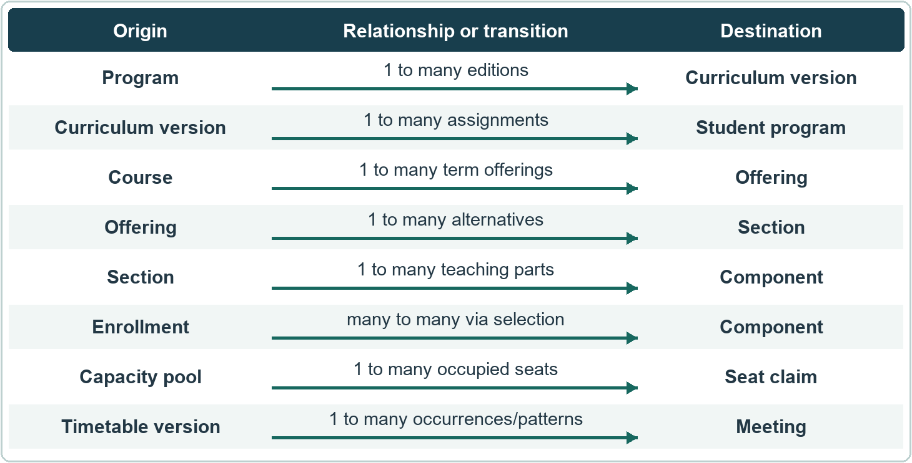

# Academic data dictionary

DOC-15 · Version 0.1 · proposed · Owner: Database reviewer

**Purpose and scope** — Interpret the SQL schema, cardinalities, ownership and historical records.

**Audience** — Data engineers and academic stewards.

**Dependencies** — [Academic domain and curriculum](05-academic-domain-curriculum.md), [Registration transactions](17-transactions-consistency.md), [Data migration and reconciliation](25-data-migration-quality.md).

## Keys, history and precision
The native SQL is the column-level dictionary. Each declaration specifies type, optionality, default, references, keys and checks. Every table has a single write owner in the module catalog. Opaque API IDs map to internal keys. Numeric credits use fixed decimal scale; preserve the course credit value at offering and enrollment time. A nullable grade is evidence still missing or inapplicable and cannot count as a pass.

## Entity dictionary by write owner
Names below match the DDL. Each identity column is generated inside PostgreSQL. Composite primary keys identify relationships; PostgreSQL makes their columns non-null. A nullable reference is optional only in the state allowed by the domain. An owner can authorize a transaction-scoped repository to perform its writes.

| Owner and tables | Interpretation |
| --- | --- |
| Identity — identity_account, role_assignment | Resolve subject and scoped assignments. |
| Institution — org_unit, program | Manage organizational boundaries. |
| Catalog — course, equivalency | Maintain canonical courses and substitutions. |
| Curricula — curriculum_version, curriculum_course | Own immutable student requirement sets. |
| Records — student_program, academic_record | Post traceable attempts and corrections. |
| Instructors — instructor, qualification, availability | Approve skills and availability. |
| Policies — policy_version, academic_rule | Compile typed rules without database access. |
| Calendar — term, appointment | Maintain decision windows and term coordination. |
| Resources — room, room_feature | Maintain usable spaces and accessibility features. |
| Offerings — offering, section, component, capacity_pool, reservation | Specify instructional bundles and physical capacity. |
| Timetabling — timetable_version, meeting, solve_job, validation_record | Validate proposals and publish pinned versions. |
| Approvals — exception_grant, review_case | Grant scoped exceptions with maker/checker control. |
| Enrollment — student_term, enrollment, enrollment_component, waitlist, seat_claim, idempotency_record, queue_guard | Coordinate all mutations and seat use. |
| Audit — audit_entry | Append attributable academic decisions via transaction port. |
| Notifications — consumer_receipt | Deduplicate delivery and track attempts. |
| Events — outbox_event | Relay committed changes and order per aggregate. |

## Integrity allocation
|Invariant|Enforcement and evidence|
|---|---|
|INV-001 Occupancy bounded by pool capacity|Seat claims count active enrollments plus live offers. Writers serialize claims, releases and quota changes under pool locks.|
|INV-002 One active canonical course per student and term|Partial unique index one_active_course. Domain also resolves cross-listed equivalencies before writing.|
|INV-003 Complete compatible bundle|Application validates component parent, section, term and compatibility. Foreign keys preserve row references.|
|INV-004 One academic credit award per offering registration|Enrollment holds frozen credit_value. Component rows carry no additional credit value.|
|INV-005 Single current publication per term|Partial unique index and atomic supersession with versioned validation.|
|INV-006 Attributable change and notification|Insert audit and outbox in the same transaction; consumer receipts deduplicate effects.|
## Query paths and corrections
Select current roster through the active-course index and student-term key. queue_order supports deterministic head lookup. pool_claims supports recount under the pool guard. outbox_pending bounds relay scans. Add further indexes only after measuring representative plans. Enforce parent and child term consistency, assignment scope, reserve sums and policy immutability in the owning service with a locked decision context. The DDL illustrates the write model; report projections, full workflow case files and provider-specific data belong in later migrations.
Append a new academic_record revision referencing supersedes. Reject cycles, incorrect attempt lineage or multiple current revisions. Keep original policy, enrollment and publication records traceable with the audit stream. Archive or anonymize only under approved retention and legal decisions.

## Decision and open question
Proposed: Use fixed decimal credit and explicit revision lineage. Assumed: Stable source identifiers exist for student, course and term.

Needs approval (RISK-001) — Thresholds, GPA scales, exception and sharing parameters. Academic senate delegate: Approve policy editions, samples and applicability.

## References
[core schema](../artifacts/core-schema.sql) · [module catalog](../artifacts/module-catalog.yaml)
