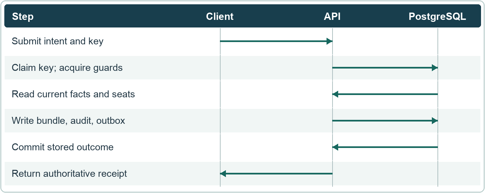

# Registration transactions

DOC-17 · Version 0.1 · proposed · Owner: Database reviewer

**Purpose and scope** — Make final-set and capacity decisions under concurrent writes.

**Audience** — Backend engineers, reviewers and testers.

**Dependencies** — [Academic rule evaluation](06-academic-rule-engine.md), [Enrollment and waitlists](09-enrollment-waitlist.md), [Academic data dictionary](15-data-model-dictionary.md), [API contracts and errors](16-api-contracts-errors.md).

## Lock protocol and decision point
Use PostgreSQL READ COMMITTED with explicit locked guard rows. Re-read facts after acquiring guards. Coordination relies on every authoritative writer following the protocol, including staff, approval, data import, grade changes and workers. SERIALIZABLE can detect additional dependency anomalies but adds aborts and still requires retries and idempotency. Prove this narrower contract with real competing connections.
|Order|Lock and scope|Writers covered|
|---|---|---|
|1|Claim idempotency row in unique actor/operation/key namespace|Original and repeated commands. Validate payload hash including subject and term.|
|2|Term rows ascending, shared for registration; exclusive for changes to shared rules, appointments, grants affecting a term or publication|Epoch writers increment in the same transaction. Multi-term changes lock all affected terms.|
|3|Per-term queue_guard exclusively on every operation changing seats, quotas or queue position|Serializes overlapping bundles and queue head selection; a deliberate throughput cost to benchmark.|
|4|Student-term rows by term then student ID|All changes affecting eligibility, records and enrollment, including staff and worker writes.|
|5|Distinct capacity_pool rows by ID, then dependent claim and enrollment rows by ID|Cross-listed pools, linked sections, expiring holds and final mutations.|
Acquire any necessary broader guard first. For a grade correction, discover affected terms under a stable student-record coordination protocol: roster of affected terms and creation of new student-term rows both coordinate on an identity row before step 2. All operations needing that row take it before any term. Ordinary enrollment uses its existing term guard and never subsequently takes the identity row. Concurrent changes to role assignments use the same relevant term fences, including all terms governed by a broader grant. Retry discovery if the affected set changes.
## Command pseudocode
```
authorize session and syntactic command; hash canonical operation, subject and body
begin; claim key or return stored outcome after scope check
lock term, queue guard, student-term and distinct pools in global order
reread calendar, grants, grades, policy, queue and current publication
compute final set and deduplicated pool deltas across add/drop legs
sample database decision time; check window, grant expiry and offer expiry
check active course uniqueness, eligibility, queue priority and all pool budgets
if denied: store finished error, audit decision, commit with no academic mutation
else: apply all changes; append audit + outbox; store receipt; commit
```
First insert processing in the mutation transaction. A simultaneous insert waits on uniqueness. On abort the key is available again; on commit the loser reads the stored response. Canonicalize JSON keys and decimal representations; sort set-like IDs and reject duplicates. A changed payload at the same key returns ERR-006. Persist deterministic refusals too. Check current authorization before revealing a saved outcome. Retain keys for KEY_RETENTION longer than the approved retry horizon. Once expired, require reconciliation of current academic state before a new intent.
On deadlock (40P01) or serialization failure (40001), abort and retry the whole transaction with bounded exponential jitter within RETRY_COUNT and RETRY_BUDGET. Re-evaluate time and all facts. On exhaustion return ERR-010 with retry guidance. Never hold locks across provider, cache or solver calls. Claim reconciliation compares live enrollment bundles and active offers to physical seat_claim rows under the same locks; freeze affected writes and audit discrepancies before correction.


## Decision and open question
Proposed: Coordinate final decisions with ordered database guards. Assumed: Every writer of guarded facts follows the same lock protocol.

Needs approval (RISK-008) — Shared term guards and hot capacity pools. Database reviewer: Run real PostgreSQL contention tests and tune.

## References
[core schema](../artifacts/core-schema.sql) · [test scenarios](../artifacts/test-scenarios.yaml)

[Explicit Locking](https://www.postgresql.org/docs/17/explicit-locking.html) · [Transactions](https://www.prisma.io/docs/orm/fundamentals/transactions)
