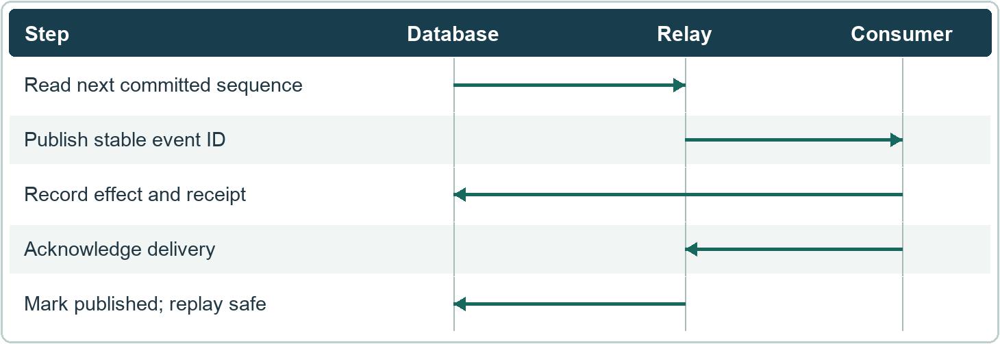

# Events, jobs and integrations

DOC-18 · Version 0.1 · proposed · Owner: Integration lead

**Purpose and scope** — Recover asynchronous effects using authoritative database facts.

**Audience** — Worker engineers and operations.

**Dependencies** — [Nest.js application design](13-nestjs-backend-design.md), [Registration transactions](17-transactions-consistency.md), [Recovery and incident runbooks](24-backup-disaster-recovery-runbooks.md).

## Outbox and work recovery
Store the versioned event envelope with the academic write. Its fields identify event, source, schema version, aggregate sequence, term, occurrence, causation, correlation and permitted payload. Relay the oldest unpublished sequence per aggregate. Relay workers may partition independent aggregates; any ordering lock belongs to publication mechanics and cannot determine academic priority. Mark published only after broker acceptance. Crash after send permits duplicate delivery.
A consumer records its receipt in the same transaction as local effects. For an external effect use an intent with a stable provider idempotency key. Resolve ambiguous responses using the provider’s status endpoint or reconciliation. Hold ambiguous deliveries for controlled review where the provider cannot deduplicate. Retry transient failures with bounded backoff, quarantine invalid/permanent messages with reason and payload reference, and replay under the original event ID after correction and authorization.

## Integration contracts
|System and authority|Trust and timing|Outage and reconciliation|
|---|---|---|
|Identity provider owns issuer/subject and authentication state.|Verify signed tokens, issuer, audience, freshness and key rotation. Bound lookup by IDP_TIMEOUT.|Fail closed for new sessions. Reconcile deprovisioning and active assignments before token/session renewal.|
|Academic core owns enrollment. Finance owns financial holds and balances.|Service credentials, signed callbacks, external reference and effective time. FINANCE_TIMEOUT bounds adapter work.|Keep last verified freshness. Apply approved hold policy or route to pending review. Reconcile by period and external reference.|
|Core owns rosters; learning platform owns learning activity.|Authenticated service account, signed webhook, roster revision and LMS_TIMEOUT.|Buffer outbox events, deduplicate and compare authoritative roster snapshots after recovery.|
|Core owns contact authorization; provider owns dispatch receipt.|Scoped credentials, signature/timestamp checks and SEND_TIMEOUT.|Retry by delivery key. Reconcile provider receipts; quarantine unresolved sends.|
## Replay decision
On timeout before a provider response, preserve the same event and delivery reference, query provider status and reconcile before issuing another irreversible effect. A consumer observing sequence n+2 before n+1 pauses that aggregate, retrieves the gap, then resumes in order. Other aggregates can continue. Record the initiating operator and reason for a replay; a new schema version needs a compatible converter before quarantine release.

## Durable job state
SolveJob carries a generation-fenced lease. A stale worker cannot complete a later attempt. Apply the same pattern to exports and notification batches. Separate transient retry from a poison job. Preserve the last error class, next eligible retry, first failure time and operator action. Redis queue loss is recoverable from outstanding persistent jobs and outbox data. A replay of finance events must reuse the original financial reference.

## Decision and open question
Proposed: Publish recoverable events at least once and deduplicate consumer effects. Assumed: Adapters can correlate provider references with durable events.

Needs approval (RISK-009) — Third-party finance hold freshness and outages. Finance owner: Ratify outage posture before adapter activation.

## References
[event catalog](../artifacts/event-catalog.yaml) · [event.schema](../artifacts/schemas/event.schema.json) · [event](../artifacts/examples/event.json)

[Going to production](https://docs.bullmq.io/guide/going-to-production)
